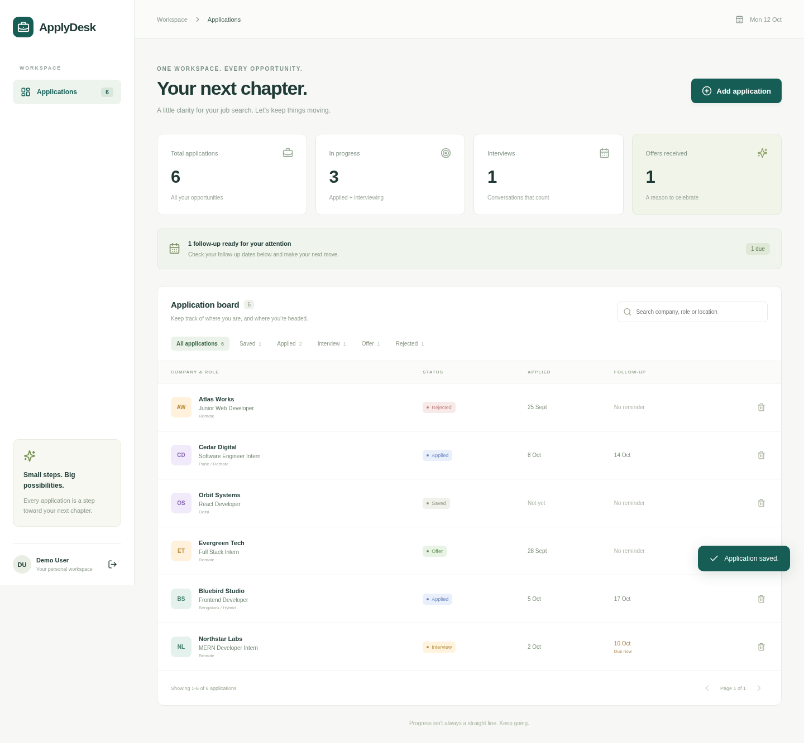

# ApplyDesk

A focused MERN workspace for job applications. Save opportunities, track each stage, and keep follow-up dates and notes together. Each account has its own private board.



## Features

- Register, sign in and sign out with HTTP-only session cookies.
- Create, edit and delete applications with company, role, location, job link and notes.
- Move applications through Saved, Applied, Interview, Offer and Rejected.
- Search company, role or location; filter by stage; paginate results.
- Dashboard totals and follow-ups due today or earlier.
- Responsive layout, keyboard-accessible forms, native dialog focus trapping, empty/loading/error states.

## Stack

MongoDB + Mongoose, Express 5, React 19, Node.js 22, Vite, Zod, bcrypt, JWT, Helmet. Plain CSS keeps the small UI easy to change. Lucide provides icons.

## Setup

Requirements: Node.js 22+, npm, and MongoDB (local Community Server or an Atlas connection string).

```bash
git clone https://github.com/Lakshya0604/applydesk.git
cd applydesk
npm ci
cp server/.env.example server/.env
```

Edit `server/.env`:

```dotenv
PORT=4000
MONGODB_URI=mongodb://127.0.0.1:27017/applydesk
JWT_SECRET=your-own-random-secret-at-least-32-characters
NODE_ENV=development
```

Generate a secret with `node -e "console.log(require('crypto').randomBytes(48).toString('hex'))"`. Never commit `.env` or use the example secret in production.

```bash
npm run dev
```

Open http://localhost:5173. Vite forwards `/api` to the API on port 4000. Create your own account and add an application. No third-party API key is required to run the app.

### Production-style local run

```bash
npm run build
```

Set `NODE_ENV=production` in `server/.env`, then run `npm start`. Express serves the built frontend and API together on port 4000. Production cookies require HTTPS: use a TLS reverse proxy for a deployment. For a plain HTTP local preview, leave `NODE_ENV=development` and use `npm run dev` instead.

## Tests

```bash
npm test
npm run build
```

The 10 API integration tests start a temporary real MongoDB process using `mongodb-memory-server`; the first run downloads its binary. Tests cover auth validation, hashing/cookies, duplicates, CRUD persistence, URL/date/status validation, literal search, pagination, stats, per-user isolation, PATCH field preservation, content-type checks and logout.

For the optional browser smoke test, start the app on port 4000 (or set `BASE_URL` to the frontend URL), then:

```bash
npx playwright install chromium
npm run test:ui -w client
```

This creates throwaway accounts and sample applications in the configured database. Use a test database. It checks registration, CRUD creation/editing, filters, search, mobile rendering and logout, and refreshes the screenshots in `docs/`.

## API

All application endpoints require a session. Send JSON bodies. Errors use `{ "error": "message" }`, optionally with field details.

| Method | Path | Purpose |
| --- | --- | --- |
| POST | `/api/auth/register` | Create account (`name`, `email`, `password`) |
| POST | `/api/auth/login` | Sign in (`email`, `password`) |
| GET | `/api/auth/me` | Current account |
| POST | `/api/auth/logout` | Clear session |
| GET | `/api/applications` | List; `q`, `status`, `page`, `limit` |
| POST | `/api/applications` | Create application |
| PATCH | `/api/applications/:id` | Update selected fields |
| DELETE | `/api/applications/:id` | Delete owned application |
| GET | `/api/applications/stats` | Global totals and due follow-ups |
| GET | `/api/health` | Process health |

`company` and `role` are required when creating. Other fields: `status`, `location`, `url`, `notes`, `appliedAt`, `followUpAt`. Dates use `YYYY-MM-DD`; send `null` or an empty string to clear them.

## Design decisions

- **Ownership in every query:** application reads, updates, deletes and stats include the authenticated user ID. Another account cannot use an application ID to change its data.
- **HTTP-only cookies:** session tokens are not exposed to browser JavaScript. SameSite=Strict, JSON-only mutations and no CORS restrict cross-site requests. Production uses Secure cookies. bcrypt hashes passwords; auth routes are rate-limited.
- **Validation at the API boundary:** Zod rejects unknown fields and unsafe link schemes. PATCH strips defaults before making fields optional, so updating a status does not erase notes or dates. MongoDB validates updates too.
- **Indexes and bounded results:** indexes support owner/status/date queries; page size is capped at 50. Search escapes regex input. A small tracker does not need a separate search service.
- **Date-only follow-ups:** stored at UTC midnight; due calculations use UTC calendar dates consistently. These are on-board reminders, not scheduled email notifications.
- **Small scope:** no scraping, automatic applications, job recommendations, password recovery, email verification or shared/team boards. Sessions last seven days; logout clears the browser cookie, but there is no server-side token revocation list. Those are sensible next steps for a production product.

## Project structure

```text
client/src/           React interface, fetch wrapper and styles
server/src/models/   MongoDB schemas and indexes
server/src/routes/   Authentication and application REST endpoints
server/src/middleware/ Session authentication
server/test/         API integration tests
docs/                Screenshots using fictional demo data
```

## Code0 workflow / AI development experience

**Work in progress: not yet a final assessment submission.** Code0 (`frigga.code0` 1.1.9) is installed in a disposable VS Code environment. Git initialization, component/API/test commits and the first pushes ran through that environment's integrated terminal. Frigga setup is being completed with access limited to this public repository. The 3-5 specific Code0 assistance tasks will be documented here only after they have actually been completed and validated.

## Screenshots

The names and applications shown are fictional sample data, not a real job-search history.

- [Sign-in screen](docs/sign-in.png)
- [Desktop board](docs/dashboard-desktop.png)
- [Mobile board](docs/dashboard-mobile.png)
- [Application editor](docs/edit-application.png)
